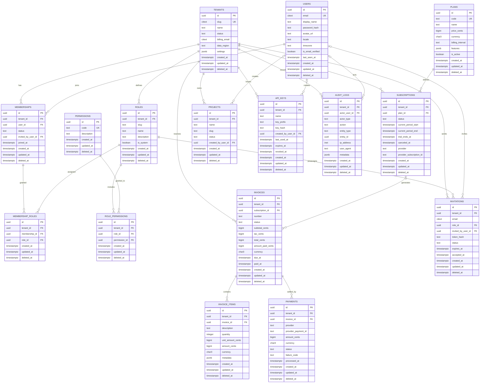

# Example Output: Multi-Tenant SaaS Platform

> Generated by **db-schema-assistant**. This is a complete reference response for a B2B SaaS platform with tenant isolation, role-based access control, subscription billing, API keys, invitations, projects, and an append-only audit trail.
>
> Target: **PostgreSQL 15+**. The same model is portable to MySQL, Prisma, and TypeORM using the dialect rules in [`../SKILL.md`](../SKILL.md).

## Assumptions & Scope

- The product is a B2B multi-tenant SaaS platform; one user can belong to multiple tenants.
- PostgreSQL 15+ is the target. `pgcrypto` and `citext` are available.
- Primary keys are UUIDv4. Money is stored as integer minor units (cents), never floating point.
- Timestamps are UTC. Business entities use soft deletes. Audit logs are append-only.
- Authentication, payment capture, email delivery, and file storage are application concerns and are out of scope.
- Tenant isolation is enforced by composite foreign keys where tenant-owned rows reference each other; PostgreSQL RLS is recommended as defense in depth.

## 1. Mermaid ERD



## 2. Executable Schema

### PostgreSQL 15+

```sql
BEGIN;

CREATE EXTENSION IF NOT EXISTS pgcrypto;
CREATE EXTENSION IF NOT EXISTS citext;

-- Reusable trigger for updated_at. Every mutable table gets this trigger.
CREATE OR REPLACE FUNCTION set_updated_at()
RETURNS trigger
LANGUAGE plpgsql
AS $$
BEGIN
  NEW.updated_at = now();
  RETURN NEW;
END;
$$;

-- ---------------------------------------------------------------------------
-- Tenants
-- ---------------------------------------------------------------------------
CREATE TABLE tenants (
  id uuid PRIMARY KEY DEFAULT gen_random_uuid(),
  slug citext NOT NULL,
  name text NOT NULL,
  status text NOT NULL DEFAULT 'active',
  billing_email citext NOT NULL,
  data_region text NOT NULL DEFAULT 'us',
  settings jsonb NOT NULL DEFAULT '{}'::jsonb,
  created_at timestamptz NOT NULL DEFAULT now(),
  updated_at timestamptz NOT NULL DEFAULT now(),
  deleted_at timestamptz,
  CONSTRAINT ck_tenants__slug_format
    CHECK (slug::text ~ '^[a-z][a-z0-9-]{1,61}[a-z0-9]$'),
  CONSTRAINT ck_tenants__name_length
    CHECK (char_length(name) BETWEEN 1 AND 120),
  CONSTRAINT ck_tenants__status
    CHECK (status IN ('active', 'suspended', 'closed')),
  CONSTRAINT ck_tenants__billing_email
    CHECK (position('@' in billing_email::text) > 1 AND char_length(billing_email::text) <= 320),
  CONSTRAINT ck_tenants__data_region
    CHECK (data_region IN ('us', 'eu', 'ap')),
  CONSTRAINT ck_tenants__settings_object
    CHECK (jsonb_typeof(settings) = 'object')
);

-- ---------------------------------------------------------------------------
-- Global users
-- ---------------------------------------------------------------------------
CREATE TABLE users (
  id uuid PRIMARY KEY DEFAULT gen_random_uuid(),
  email citext NOT NULL,
  display_name text NOT NULL,
  password_hash text,
  avatar_url text,
  locale text NOT NULL DEFAULT 'en',
  timezone text NOT NULL DEFAULT 'UTC',
  is_email_verified boolean NOT NULL DEFAULT false,
  last_seen_at timestamptz,
  created_at timestamptz NOT NULL DEFAULT now(),
  updated_at timestamptz NOT NULL DEFAULT now(),
  deleted_at timestamptz,
  CONSTRAINT ck_users__email
    CHECK (position('@' in email::text) > 1 AND char_length(email::text) <= 320),
  CONSTRAINT ck_users__display_name
    CHECK (char_length(display_name) BETWEEN 1 AND 120),
  CONSTRAINT ck_users__password_hash
    CHECK (password_hash IS NULL OR char_length(password_hash) >= 20),
  CONSTRAINT ck_users__locale
    CHECK (locale ~ '^[a-z]{2}(-[A-Z]{2})?$'),
  CONSTRAINT ck_users__timezone
    CHECK (char_length(timezone) BETWEEN 1 AND 64)
);

-- ---------------------------------------------------------------------------
-- Plans and permissions are global reference data.
-- ---------------------------------------------------------------------------
CREATE TABLE plans (
  id uuid PRIMARY KEY DEFAULT gen_random_uuid(),
  code text NOT NULL,
  name text NOT NULL,
  price_cents bigint NOT NULL,
  currency char(3) NOT NULL DEFAULT 'USD',
  billing_interval text NOT NULL,
  features jsonb NOT NULL DEFAULT '{}'::jsonb,
  is_active boolean NOT NULL DEFAULT true,
  created_at timestamptz NOT NULL DEFAULT now(),
  updated_at timestamptz NOT NULL DEFAULT now(),
  deleted_at timestamptz,
  CONSTRAINT ck_plans__code_format
    CHECK (code ~ '^[a-z][a-z0-9_-]{1,39}$'),
  CONSTRAINT ck_plans__name_length
    CHECK (char_length(name) BETWEEN 1 AND 80),
  CONSTRAINT ck_plans__price_nonnegative
    CHECK (price_cents >= 0),
  CONSTRAINT ck_plans__currency
    CHECK (currency ~ '^[A-Z]{3}$'),
  CONSTRAINT ck_plans__billing_interval
    CHECK (billing_interval IN ('month', 'year')),
  CONSTRAINT ck_plans__features_object
    CHECK (jsonb_typeof(features) = 'object')
);

CREATE TABLE permissions (
  id uuid PRIMARY KEY DEFAULT gen_random_uuid(),
  code text NOT NULL,
  description text,
  created_at timestamptz NOT NULL DEFAULT now(),
  updated_at timestamptz NOT NULL DEFAULT now(),
  deleted_at timestamptz,
  CONSTRAINT ck_permissions__code_format
    CHECK (code ~ '^[a-z][a-z0-9_.]{2,79}$'),
  CONSTRAINT ck_permissions__description_length
    CHECK (description IS NULL OR char_length(description) <= 500)
);

-- ---------------------------------------------------------------------------
-- Tenant roles and permission grants
-- ---------------------------------------------------------------------------
CREATE TABLE roles (
  id uuid PRIMARY KEY DEFAULT gen_random_uuid(),
  tenant_id uuid NOT NULL,
  slug text NOT NULL,
  name text NOT NULL,
  description text,
  is_system boolean NOT NULL DEFAULT false,
  created_at timestamptz NOT NULL DEFAULT now(),
  updated_at timestamptz NOT NULL DEFAULT now(),
  deleted_at timestamptz,
  CONSTRAINT fk_roles__tenant
    FOREIGN KEY (tenant_id) REFERENCES tenants (id)
    ON DELETE RESTRICT ON UPDATE CASCADE,
  CONSTRAINT uq_roles__tenant_id_id
    UNIQUE (tenant_id, id),
  CONSTRAINT ck_roles__slug_format
    CHECK (slug ~ '^[a-z][a-z0-9_]{1,39}$'),
  CONSTRAINT ck_roles__name_length
    CHECK (char_length(name) BETWEEN 1 AND 80),
  CONSTRAINT ck_roles__description_length
    CHECK (description IS NULL OR char_length(description) <= 500)
);

CREATE TABLE role_permissions (
  id uuid PRIMARY KEY DEFAULT gen_random_uuid(),
  tenant_id uuid NOT NULL,
  role_id uuid NOT NULL,
  permission_id uuid NOT NULL,
  created_at timestamptz NOT NULL DEFAULT now(),
  updated_at timestamptz NOT NULL DEFAULT now(),
  deleted_at timestamptz,
  CONSTRAINT fk_role_permissions__role
    FOREIGN KEY (tenant_id, role_id) REFERENCES roles (tenant_id, id)
    ON DELETE CASCADE ON UPDATE CASCADE,
  CONSTRAINT fk_role_permissions__permission
    FOREIGN KEY (permission_id) REFERENCES permissions (id)
    ON DELETE RESTRICT ON UPDATE CASCADE
);

-- ---------------------------------------------------------------------------
-- Memberships and role assignments
-- ---------------------------------------------------------------------------
CREATE TABLE memberships (
  id uuid PRIMARY KEY DEFAULT gen_random_uuid(),
  tenant_id uuid NOT NULL,
  user_id uuid NOT NULL,
  status text NOT NULL DEFAULT 'active',
  invited_by_user_id uuid,
  joined_at timestamptz,
  created_at timestamptz NOT NULL DEFAULT now(),
  updated_at timestamptz NOT NULL DEFAULT now(),
  deleted_at timestamptz,
  CONSTRAINT fk_memberships__tenant
    FOREIGN KEY (tenant_id) REFERENCES tenants (id)
    ON DELETE RESTRICT ON UPDATE CASCADE,
  CONSTRAINT fk_memberships__user
    FOREIGN KEY (user_id) REFERENCES users (id)
    ON DELETE RESTRICT ON UPDATE CASCADE,
  CONSTRAINT fk_memberships__invited_by
    FOREIGN KEY (invited_by_user_id) REFERENCES users (id)
    ON DELETE SET NULL ON UPDATE CASCADE,
  CONSTRAINT uq_memberships__tenant_id_id
    UNIQUE (tenant_id, id),
  CONSTRAINT ck_memberships__status
    CHECK (status IN ('invited', 'active', 'suspended', 'removed')),
  CONSTRAINT ck_memberships__active_has_joined_at
    CHECK (status <> 'active' OR joined_at IS NOT NULL),
  CONSTRAINT ck_memberships__joined_after_created
    CHECK (joined_at IS NULL OR joined_at >= created_at)
);

CREATE TABLE membership_roles (
  id uuid PRIMARY KEY DEFAULT gen_random_uuid(),
  tenant_id uuid NOT NULL,
  membership_id uuid NOT NULL,
  role_id uuid NOT NULL,
  created_at timestamptz NOT NULL DEFAULT now(),
  updated_at timestamptz NOT NULL DEFAULT now(),
  deleted_at timestamptz,
  CONSTRAINT fk_membership_roles__membership
    FOREIGN KEY (tenant_id, membership_id) REFERENCES memberships (tenant_id, id)
    ON DELETE CASCADE ON UPDATE CASCADE,
  CONSTRAINT fk_membership_roles__role
    FOREIGN KEY (tenant_id, role_id) REFERENCES roles (tenant_id, id)
    ON DELETE RESTRICT ON UPDATE CASCADE
);

-- ---------------------------------------------------------------------------
-- Subscriptions and billing
-- ---------------------------------------------------------------------------
CREATE TABLE subscriptions (
  id uuid PRIMARY KEY DEFAULT gen_random_uuid(),
  tenant_id uuid NOT NULL,
  plan_id uuid NOT NULL,
  status text NOT NULL,
  current_period_start timestamptz NOT NULL,
  current_period_end timestamptz NOT NULL,
  trial_ends_at timestamptz,
  canceled_at timestamptz,
  provider text NOT NULL DEFAULT 'manual',
  provider_subscription_id text,
  created_at timestamptz NOT NULL DEFAULT now(),
  updated_at timestamptz NOT NULL DEFAULT now(),
  deleted_at timestamptz,
  CONSTRAINT fk_subscriptions__tenant
    FOREIGN KEY (tenant_id) REFERENCES tenants (id)
    ON DELETE RESTRICT ON UPDATE CASCADE,
  CONSTRAINT fk_subscriptions__plan
    FOREIGN KEY (plan_id) REFERENCES plans (id)
    ON DELETE RESTRICT ON UPDATE CASCADE,
  CONSTRAINT uq_subscriptions__tenant_id_id
    UNIQUE (tenant_id, id),
  CONSTRAINT ck_subscriptions__status
    CHECK (status IN ('trialing', 'active', 'past_due', 'canceled', 'paused')),
  CONSTRAINT ck_subscriptions__period_order
    CHECK (current_period_end > current_period_start),
  CONSTRAINT ck_subscriptions__trial_window
    CHECK (trial_ends_at IS NULL OR trial_ends_at >= current_period_start),
  CONSTRAINT ck_subscriptions__canceled_at_required
    CHECK (status <> 'canceled' OR canceled_at IS NOT NULL),
  CONSTRAINT ck_subscriptions__canceled_after_start
    CHECK (canceled_at IS NULL OR canceled_at >= current_period_start),
  CONSTRAINT ck_subscriptions__provider
    CHECK (provider IN ('stripe', 'paddle', 'manual')),
  CONSTRAINT ck_subscriptions__provider_id_length
    CHECK (provider_subscription_id IS NULL OR char_length(provider_subscription_id) BETWEEN 1 AND 255)
);

CREATE TABLE invoices (
  id uuid PRIMARY KEY DEFAULT gen_random_uuid(),
  tenant_id uuid NOT NULL,
  subscription_id uuid,
  number text NOT NULL,
  status text NOT NULL DEFAULT 'draft',
  subtotal_cents bigint NOT NULL,
  tax_cents bigint NOT NULL DEFAULT 0,
  total_cents bigint NOT NULL,
  amount_paid_cents bigint NOT NULL DEFAULT 0,
  currency char(3) NOT NULL DEFAULT 'USD',
  due_at timestamptz NOT NULL,
  paid_at timestamptz,
  created_at timestamptz NOT NULL DEFAULT now(),
  updated_at timestamptz NOT NULL DEFAULT now(),
  deleted_at timestamptz,
  CONSTRAINT fk_invoices__tenant
    FOREIGN KEY (tenant_id) REFERENCES tenants (id)
    ON DELETE RESTRICT ON UPDATE CASCADE,
  CONSTRAINT fk_invoices__subscription
    FOREIGN KEY (tenant_id, subscription_id) REFERENCES subscriptions (tenant_id, id)
    ON DELETE RESTRICT ON UPDATE CASCADE,
  CONSTRAINT uq_invoices__tenant_id_id
    UNIQUE (tenant_id, id),
  CONSTRAINT ck_invoices__number_format
    CHECK (number ~ '^[A-Z0-9][A-Z0-9-]{3,39}$'),
  CONSTRAINT ck_invoices__status
    CHECK (status IN ('draft', 'open', 'paid', 'void', 'uncollectible')),
  CONSTRAINT ck_invoices__amounts_nonnegative
    CHECK (subtotal_cents >= 0 AND tax_cents >= 0 AND total_cents >= 0 AND amount_paid_cents >= 0),
  CONSTRAINT ck_invoices__total_matches_components
    CHECK (total_cents = subtotal_cents + tax_cents),
  CONSTRAINT ck_invoices__paid_not_over_total
    CHECK (amount_paid_cents <= total_cents),
  CONSTRAINT ck_invoices__currency
    CHECK (currency ~ '^[A-Z]{3}$'),
  CONSTRAINT ck_invoices__due_after_created
    CHECK (due_at >= created_at),
  CONSTRAINT ck_invoices__paid_at_required
    CHECK (status <> 'paid' OR paid_at IS NOT NULL),
  CONSTRAINT ck_invoices__paid_at_after_created
    CHECK (paid_at IS NULL OR paid_at >= created_at)
);

CREATE TABLE invoice_items (
  id uuid PRIMARY KEY DEFAULT gen_random_uuid(),
  tenant_id uuid NOT NULL,
  invoice_id uuid NOT NULL,
  description text NOT NULL,
  quantity integer NOT NULL,
  unit_amount_cents bigint NOT NULL,
  amount_cents bigint GENERATED ALWAYS AS (quantity::bigint * unit_amount_cents) STORED,
  currency char(3) NOT NULL DEFAULT 'USD',
  metadata jsonb NOT NULL DEFAULT '{}'::jsonb,
  created_at timestamptz NOT NULL DEFAULT now(),
  updated_at timestamptz NOT NULL DEFAULT now(),
  deleted_at timestamptz,
  CONSTRAINT fk_invoice_items__invoice
    FOREIGN KEY (tenant_id, invoice_id) REFERENCES invoices (tenant_id, id)
    ON DELETE CASCADE ON UPDATE CASCADE,
  CONSTRAINT ck_invoice_items__description_length
    CHECK (char_length(description) BETWEEN 1 AND 500),
  CONSTRAINT ck_invoice_items__quantity_positive
    CHECK (quantity > 0),
  CONSTRAINT ck_invoice_items__unit_amount_nonnegative
    CHECK (unit_amount_cents >= 0),
  CONSTRAINT ck_invoice_items__amount_nonnegative
    CHECK (amount_cents >= 0),
  CONSTRAINT ck_invoice_items__currency
    CHECK (currency ~ '^[A-Z]{3}$'),
  CONSTRAINT ck_invoice_items__metadata_object
    CHECK (jsonb_typeof(metadata) = 'object')
);

CREATE TABLE payments (
  id uuid PRIMARY KEY DEFAULT gen_random_uuid(),
  tenant_id uuid NOT NULL,
  invoice_id uuid NOT NULL,
  provider text NOT NULL,
  provider_payment_id text,
  amount_cents bigint NOT NULL,
  currency char(3) NOT NULL,
  status text NOT NULL,
  failure_code text,
  processed_at timestamptz,
  created_at timestamptz NOT NULL DEFAULT now(),
  updated_at timestamptz NOT NULL DEFAULT now(),
  deleted_at timestamptz,
  CONSTRAINT fk_payments__invoice
    FOREIGN KEY (tenant_id, invoice_id) REFERENCES invoices (tenant_id, id)
    ON DELETE RESTRICT ON UPDATE CASCADE,
  CONSTRAINT ck_payments__amount_positive
    CHECK (amount_cents > 0),
  CONSTRAINT ck_payments__currency
    CHECK (currency ~ '^[A-Z]{3}$'),
  CONSTRAINT ck_payments__status
    CHECK (status IN ('pending', 'succeeded', 'failed', 'refunded')),
  CONSTRAINT ck_payments__provider
    CHECK (provider IN ('stripe', 'paddle', 'manual')),
  CONSTRAINT ck_payments__provider_id_length
    CHECK (provider_payment_id IS NULL OR char_length(provider_payment_id) BETWEEN 1 AND 255),
  CONSTRAINT ck_payments__succeeded_at_required
    CHECK (status <> 'succeeded' OR processed_at IS NOT NULL),
  CONSTRAINT ck_payments__failure_code_required
    CHECK (status <> 'failed' OR failure_code IS NOT NULL),
  CONSTRAINT ck_payments__failure_code_only_when_failed
    CHECK (failure_code IS NULL OR status = 'failed')
);

-- ---------------------------------------------------------------------------
-- Tenant projects, API keys, invitations
-- ---------------------------------------------------------------------------
CREATE TABLE projects (
  id uuid PRIMARY KEY DEFAULT gen_random_uuid(),
  tenant_id uuid NOT NULL,
  name text NOT NULL,
  slug text NOT NULL,
  status text NOT NULL DEFAULT 'active',
  created_by_user_id uuid,
  created_at timestamptz NOT NULL DEFAULT now(),
  updated_at timestamptz NOT NULL DEFAULT now(),
  deleted_at timestamptz,
  CONSTRAINT fk_projects__tenant
    FOREIGN KEY (tenant_id) REFERENCES tenants (id)
    ON DELETE RESTRICT ON UPDATE CASCADE,
  CONSTRAINT fk_projects__created_by
    FOREIGN KEY (created_by_user_id) REFERENCES users (id)
    ON DELETE SET NULL ON UPDATE CASCADE,
  CONSTRAINT ck_projects__name_length
    CHECK (char_length(name) BETWEEN 1 AND 120),
  CONSTRAINT ck_projects__slug_format
    CHECK (slug ~ '^[a-z][a-z0-9-]{1,61}[a-z0-9]$'),
  CONSTRAINT ck_projects__status
    CHECK (status IN ('active', 'archived'))
);

CREATE TABLE api_keys (
  id uuid PRIMARY KEY DEFAULT gen_random_uuid(),
  tenant_id uuid NOT NULL,
  name text NOT NULL,
  key_prefix text NOT NULL,
  key_hash text NOT NULL,
  created_by_user_id uuid,
  last_used_at timestamptz,
  expires_at timestamptz,
  revoked_at timestamptz,
  created_at timestamptz NOT NULL DEFAULT now(),
  updated_at timestamptz NOT NULL DEFAULT now(),
  deleted_at timestamptz,
  CONSTRAINT fk_api_keys__tenant
    FOREIGN KEY (tenant_id) REFERENCES tenants (id)
    ON DELETE RESTRICT ON UPDATE CASCADE,
  CONSTRAINT fk_api_keys__created_by
    FOREIGN KEY (created_by_user_id) REFERENCES users (id)
    ON DELETE SET NULL ON UPDATE CASCADE,
  CONSTRAINT ck_api_keys__name_length
    CHECK (char_length(name) BETWEEN 1 AND 80),
  CONSTRAINT ck_api_keys__prefix_length
    CHECK (char_length(key_prefix) BETWEEN 8 AND 16),
  CONSTRAINT ck_api_keys__hash_length
    CHECK (char_length(key_hash) BETWEEN 32 AND 255),
  CONSTRAINT ck_api_keys__expiry_after_created
    CHECK (expires_at IS NULL OR expires_at > created_at),
  CONSTRAINT ck_api_keys__revoked_after_created
    CHECK (revoked_at IS NULL OR revoked_at >= created_at)
);

CREATE TABLE invitations (
  id uuid PRIMARY KEY DEFAULT gen_random_uuid(),
  tenant_id uuid NOT NULL,
  email citext NOT NULL,
  role_id uuid NOT NULL,
  invited_by_user_id uuid,
  token_hash text NOT NULL,
  status text NOT NULL DEFAULT 'pending',
  expires_at timestamptz NOT NULL,
  accepted_at timestamptz,
  created_at timestamptz NOT NULL DEFAULT now(),
  updated_at timestamptz NOT NULL DEFAULT now(),
  deleted_at timestamptz,
  CONSTRAINT fk_invitations__tenant
    FOREIGN KEY (tenant_id) REFERENCES tenants (id)
    ON DELETE RESTRICT ON UPDATE CASCADE,
  CONSTRAINT fk_invitations__role
    FOREIGN KEY (tenant_id, role_id) REFERENCES roles (tenant_id, id)
    ON DELETE RESTRICT ON UPDATE CASCADE,
  CONSTRAINT fk_invitations__invited_by
    FOREIGN KEY (invited_by_user_id) REFERENCES users (id)
    ON DELETE SET NULL ON UPDATE CASCADE,
  CONSTRAINT ck_invitations__email
    CHECK (position('@' in email::text) > 1 AND char_length(email::text) <= 320),
  CONSTRAINT ck_invitations__status
    CHECK (status IN ('pending', 'accepted', 'revoked', 'expired')),
  CONSTRAINT ck_invitations__expires_after_created
    CHECK (expires_at > created_at),
  CONSTRAINT ck_invitations__accepted_at_required
    CHECK (status <> 'accepted' OR accepted_at IS NOT NULL),
  CONSTRAINT ck_invitations__accepted_after_created
    CHECK (accepted_at IS NULL OR accepted_at >= created_at),
  CONSTRAINT ck_invitations__token_hash_length
    CHECK (char_length(token_hash) BETWEEN 32 AND 255)
);

-- ---------------------------------------------------------------------------
-- Append-only audit trail
-- ---------------------------------------------------------------------------
CREATE TABLE audit_logs (
  id uuid PRIMARY KEY DEFAULT gen_random_uuid(),
  tenant_id uuid NOT NULL,
  actor_user_id uuid,
  actor_type text NOT NULL,
  action text NOT NULL,
  entity_type text NOT NULL,
  entity_id uuid,
  ip_address inet,
  user_agent text,
  metadata jsonb NOT NULL DEFAULT '{}'::jsonb,
  created_at timestamptz NOT NULL DEFAULT now(),
  updated_at timestamptz NOT NULL DEFAULT now(),
  deleted_at timestamptz,
  CONSTRAINT fk_audit_logs__tenant
    FOREIGN KEY (tenant_id) REFERENCES tenants (id)
    ON DELETE RESTRICT ON UPDATE CASCADE,
  CONSTRAINT fk_audit_logs__actor
    FOREIGN KEY (actor_user_id) REFERENCES users (id)
    ON DELETE RESTRICT ON UPDATE CASCADE,
  CONSTRAINT ck_audit_logs__actor_type
    CHECK (actor_type IN ('user', 'api_key', 'system')),
  CONSTRAINT ck_audit_logs__actor_presence
    CHECK (actor_type <> 'user' OR actor_user_id IS NOT NULL),
  CONSTRAINT ck_audit_logs__action_format
    CHECK (action ~ '^[a-z][a-z0-9_.]{2,79}$'),
  CONSTRAINT ck_audit_logs__entity_type_format
    CHECK (entity_type ~ '^[a-z][a-z0-9_]{1,39}$'),
  CONSTRAINT ck_audit_logs__user_agent_length
    CHECK (user_agent IS NULL OR char_length(user_agent) <= 1024),
  CONSTRAINT ck_audit_logs__metadata_object
    CHECK (jsonb_typeof(metadata) = 'object')
);

COMMENT ON TABLE audit_logs IS
  'Append-only security and business audit trail. Normal application roles must not UPDATE or DELETE rows.';
COMMENT ON COLUMN invoice_items.amount_cents IS
  'Generated from quantity * unit_amount_cents to prevent arithmetic drift.';

-- ---------------------------------------------------------------------------
-- updated_at triggers for every mutable table
-- ---------------------------------------------------------------------------
DO $$
DECLARE
  target_table text;
BEGIN
  FOREACH target_table IN ARRAY ARRAY[
    'tenants',
    'users',
    'plans',
    'permissions',
    'roles',
    'role_permissions',
    'memberships',
    'membership_roles',
    'subscriptions',
    'invoices',
    'invoice_items',
    'payments',
    'projects',
    'api_keys',
    'invitations'
  ]
  LOOP
    EXECUTE format(
      'CREATE TRIGGER %I BEFORE UPDATE ON %I FOR EACH ROW EXECUTE FUNCTION set_updated_at()',
      'trg_' || target_table || '__set_updated_at',
      target_table
    );
  END LOOP;
END;
$$;

-- audit_logs is append-only. updated_at and deleted_at are retained for the
-- uniform audit-column contract but remain at their initial values.
CREATE OR REPLACE FUNCTION prevent_audit_log_mutation()
RETURNS trigger
LANGUAGE plpgsql
AS $$
BEGIN
  RAISE EXCEPTION 'audit_logs is append-only; write a new audit event instead';
END;
$$;

CREATE TRIGGER trg_audit_logs__append_only
BEFORE UPDATE OR DELETE ON audit_logs
FOR EACH ROW
EXECUTE FUNCTION prevent_audit_log_mutation();

-- ---------------------------------------------------------------------------
-- Indexes
--
-- FK indexes are full (not partial) so referential actions do not scan
-- soft-deleted rows. Query-only indexes are partial on deleted_at IS NULL.
-- ---------------------------------------------------------------------------

-- tenants
CREATE UNIQUE INDEX uq_tenants__slug_active
  ON tenants (slug)
  WHERE deleted_at IS NULL;

-- users
CREATE UNIQUE INDEX uq_users__email_active
  ON users (email)
  WHERE deleted_at IS NULL;
CREATE INDEX idx_users__last_seen_at
  ON users (last_seen_at DESC NULLS LAST)
  WHERE deleted_at IS NULL;

-- plans and permissions
CREATE UNIQUE INDEX uq_plans__code_active
  ON plans (code)
  WHERE deleted_at IS NULL;
CREATE UNIQUE INDEX uq_permissions__code_active
  ON permissions (code)
  WHERE deleted_at IS NULL;

-- roles
CREATE UNIQUE INDEX uq_roles__tenant_slug_active
  ON roles (tenant_id, slug)
  WHERE deleted_at IS NULL;

-- role_permissions
CREATE INDEX idx_role_permissions__tenant_role
  ON role_permissions (tenant_id, role_id);
CREATE INDEX idx_role_permissions__permission_id
  ON role_permissions (permission_id);
CREATE UNIQUE INDEX uq_role_permissions__role_permission_active
  ON role_permissions (tenant_id, role_id, permission_id)
  WHERE deleted_at IS NULL;

-- memberships
CREATE INDEX idx_memberships__user_id
  ON memberships (user_id);
CREATE INDEX idx_memberships__invited_by_user_id
  ON memberships (invited_by_user_id);
CREATE UNIQUE INDEX uq_memberships__tenant_user_active
  ON memberships (tenant_id, user_id)
  WHERE deleted_at IS NULL;
CREATE INDEX idx_memberships__tenant_status
  ON memberships (tenant_id, status)
  WHERE deleted_at IS NULL;

-- membership_roles
CREATE INDEX idx_membership_roles__tenant_membership
  ON membership_roles (tenant_id, membership_id);
CREATE INDEX idx_membership_roles__tenant_role
  ON membership_roles (tenant_id, role_id);
CREATE UNIQUE INDEX uq_membership_roles__membership_role_active
  ON membership_roles (tenant_id, membership_id, role_id)
  WHERE deleted_at IS NULL;

-- subscriptions
CREATE INDEX idx_subscriptions__plan_id
  ON subscriptions (plan_id);
CREATE UNIQUE INDEX uq_subscriptions__tenant_live
  ON subscriptions (tenant_id)
  WHERE deleted_at IS NULL
    AND status IN ('trialing', 'active', 'past_due', 'paused');
CREATE UNIQUE INDEX uq_subscriptions__provider_id
  ON subscriptions (provider, provider_subscription_id)
  WHERE provider_subscription_id IS NOT NULL
    AND deleted_at IS NULL;
CREATE INDEX idx_subscriptions__billing_renewal
  ON subscriptions (status, current_period_end)
  WHERE deleted_at IS NULL;
CREATE INDEX idx_subscriptions__tenant_created
  ON subscriptions (tenant_id, created_at DESC)
  WHERE deleted_at IS NULL;

-- invoices
CREATE INDEX idx_invoices__tenant_subscription
  ON invoices (tenant_id, subscription_id);
CREATE UNIQUE INDEX uq_invoices__tenant_number_active
  ON invoices (tenant_id, number)
  WHERE deleted_at IS NULL;
CREATE INDEX idx_invoices__tenant_status_due
  ON invoices (tenant_id, status, due_at)
  WHERE deleted_at IS NULL;
CREATE INDEX idx_invoices__overdue
  ON invoices (due_at)
  WHERE deleted_at IS NULL
    AND status = 'open';

-- invoice_items
CREATE INDEX idx_invoice_items__tenant_invoice
  ON invoice_items (tenant_id, invoice_id);

-- payments
CREATE INDEX idx_payments__tenant_invoice
  ON payments (tenant_id, invoice_id);
CREATE UNIQUE INDEX uq_payments__provider_payment
  ON payments (provider, provider_payment_id)
  WHERE provider_payment_id IS NOT NULL
    AND deleted_at IS NULL;
CREATE INDEX idx_payments__tenant_status_created
  ON payments (tenant_id, status, created_at DESC)
  WHERE deleted_at IS NULL;

-- projects
CREATE INDEX idx_projects__tenant_id
  ON projects (tenant_id);
CREATE INDEX idx_projects__created_by_user_id
  ON projects (created_by_user_id);
CREATE UNIQUE INDEX uq_projects__tenant_slug_active
  ON projects (tenant_id, slug)
  WHERE deleted_at IS NULL;
CREATE INDEX idx_projects__tenant_created
  ON projects (tenant_id, created_at DESC)
  WHERE deleted_at IS NULL;

-- api_keys
CREATE INDEX idx_api_keys__tenant_id
  ON api_keys (tenant_id);
CREATE INDEX idx_api_keys__created_by_user_id
  ON api_keys (created_by_user_id);
CREATE UNIQUE INDEX uq_api_keys__hash_active
  ON api_keys (key_hash)
  WHERE deleted_at IS NULL;
CREATE INDEX idx_api_keys__tenant_created
  ON api_keys (tenant_id, created_at DESC)
  WHERE deleted_at IS NULL;

-- invitations
CREATE INDEX idx_invitations__tenant_role
  ON invitations (tenant_id, role_id);
CREATE INDEX idx_invitations__invited_by_user_id
  ON invitations (invited_by_user_id);
CREATE UNIQUE INDEX uq_invitations__pending_email
  ON invitations (tenant_id, email)
  WHERE deleted_at IS NULL
    AND status = 'pending';
CREATE UNIQUE INDEX uq_invitations__token_hash_active
  ON invitations (token_hash)
  WHERE deleted_at IS NULL;
CREATE INDEX idx_invitations__tenant_status_expires
  ON invitations (tenant_id, status, expires_at)
  WHERE deleted_at IS NULL;

-- audit_logs
CREATE INDEX idx_audit_logs__tenant_created
  ON audit_logs (tenant_id, created_at DESC);
CREATE INDEX idx_audit_logs__tenant_entity
  ON audit_logs (tenant_id, entity_type, entity_id, created_at DESC);
CREATE INDEX idx_audit_logs__actor
  ON audit_logs (actor_user_id, created_at DESC)
  WHERE actor_user_id IS NOT NULL;
CREATE INDEX idx_audit_logs__metadata_gin
  ON audit_logs USING GIN (metadata jsonb_path_ops);

COMMIT;
```

## 3. Indexing & Performance Rationale

### 3.1 Query-to-index map

Primary-key and inline `UNIQUE` constraint indexes are created automatically by PostgreSQL and are not repeated below. The table lists the explicit indexes that implement a business rule or serve a named access path.

| Index | Table | Definition | Serves | Why |
| --- | --- | --- | --- | --- |
| `uq_tenants__slug_active` | `tenants` | Unique `(slug) WHERE deleted_at IS NULL` | Tenant lookup by slug | Active slugs are unique; soft-deleted tenants release the slug. |
| `uq_users__email_active` | `users` | Unique `(email) WHERE deleted_at IS NULL` | Login and registration | Prevents duplicate active accounts without blocking email reuse after deletion. |
| `idx_users__last_seen_at` | `users` | `(last_seen_at DESC NULLS LAST) WHERE deleted_at IS NULL` | Re-engagement and admin lists | Recent-first scans without indexing deleted users. |
| `uq_plans__code_active` | `plans` | Unique `(code) WHERE deleted_at IS NULL` | Plan lookup by code | Stable business key for checkout and feature gates. |
| `uq_permissions__code_active` | `permissions` | Unique `(code) WHERE deleted_at IS NULL` | Permission resolution | Prevents duplicate permission codes. |
| `uq_roles__tenant_slug_active` | `roles` | Unique `(tenant_id, slug) WHERE deleted_at IS NULL` | Role lookup within a tenant | Tenant-first; prevents duplicate active role slugs. |
| `idx_role_permissions__tenant_role` | `role_permissions` | `(tenant_id, role_id)` | FK to `roles`, role permission list | Full index for `ON DELETE CASCADE` and role detail reads. |
| `idx_role_permissions__permission_id` | `role_permissions` | `(permission_id)` | FK to `permissions`, permission audit | Full index for referential checks and reverse lookup. |
| `uq_role_permissions__role_permission_active` | `role_permissions` | Unique `(tenant_id, role_id, permission_id) WHERE deleted_at IS NULL` | Grant uniqueness | Prevents duplicate active grants while allowing re-grant after soft delete. |
| `idx_memberships__user_id` | `memberships` | `(user_id)` | FK to `users`, "my tenants" | Full index for user deletion checks and cross-tenant membership lookup. |
| `idx_memberships__invited_by_user_id` | `memberships` | `(invited_by_user_id)` | FK to `users` | Full index for `ON DELETE SET NULL`. |
| `uq_memberships__tenant_user_active` | `memberships` | Unique `(tenant_id, user_id) WHERE deleted_at IS NULL` | Membership check and invite acceptance | One active membership per user per tenant. |
| `idx_memberships__tenant_status` | `memberships` | `(tenant_id, status) WHERE deleted_at IS NULL` | Tenant member list filtered by status | Equality on tenant and status; small active working set. |
| `idx_membership_roles__tenant_membership` | `membership_roles` | `(tenant_id, membership_id)` | FK to `memberships`, membership detail | Full index for cascade checks and role list. |
| `idx_membership_roles__tenant_role` | `membership_roles` | `(tenant_id, role_id)` | FK to `roles`, role usage | Full index for `ON DELETE RESTRICT` and reverse lookup. |
| `uq_membership_roles__membership_role_active` | `membership_roles` | Unique `(tenant_id, membership_id, role_id) WHERE deleted_at IS NULL` | Role assignment uniqueness | No duplicate active role assignments. |
| `idx_subscriptions__plan_id` | `subscriptions` | `(plan_id)` | FK to `plans`, plan analytics | Full index for referential checks and plan usage counts. |
| `uq_subscriptions__tenant_live` | `subscriptions` | Unique `(tenant_id) WHERE status IN ('trialing','active','past_due','paused') AND deleted_at IS NULL` | One live subscription per tenant | Partial unique index enforces the billing invariant. |
| `uq_subscriptions__provider_id` | `subscriptions` | Unique `(provider, provider_subscription_id) WHERE provider_subscription_id IS NOT NULL AND deleted_at IS NULL` | Webhook idempotency | Prevents duplicate provider subscriptions. |
| `idx_subscriptions__billing_renewal` | `subscriptions` | `(status, current_period_end) WHERE deleted_at IS NULL` | Renewal and dunning cron | Equality on status, range/sort on period end. |
| `idx_subscriptions__tenant_created` | `subscriptions` | `(tenant_id, created_at DESC) WHERE deleted_at IS NULL` | Tenant billing history | Recent-first per tenant. |
| `idx_invoices__tenant_subscription` | `invoices` | `(tenant_id, subscription_id)` | FK to `subscriptions`, subscription invoices | Full composite index for the composite FK and invoice history. |
| `uq_invoices__tenant_number_active` | `invoices` | Unique `(tenant_id, number) WHERE deleted_at IS NULL` | Invoice number uniqueness | Numbers are unique per tenant, not globally. |
| `idx_invoices__tenant_status_due` | `invoices` | `(tenant_id, status, due_at) WHERE deleted_at IS NULL` | Tenant invoice list by status and due date | Equality, equality, range/sort. |
| `idx_invoices__overdue` | `invoices` | `(due_at) WHERE status = 'open' AND deleted_at IS NULL` | Overdue invoice job | Tiny partial index for the dunning worker. |
| `idx_invoice_items__tenant_invoice` | `invoice_items` | `(tenant_id, invoice_id)` | FK to `invoices`, invoice detail | Full index for cascade checks and line-item reads. |
| `idx_payments__tenant_invoice` | `payments` | `(tenant_id, invoice_id)` | FK to `invoices`, payment history | Full index for restrict checks and invoice detail. |
| `uq_payments__provider_payment` | `payments` | Unique `(provider, provider_payment_id) WHERE provider_payment_id IS NOT NULL AND deleted_at IS NULL` | Webhook idempotency | Prevents duplicate capture for the same provider payment. |
| `idx_payments__tenant_status_created` | `payments` | `(tenant_id, status, created_at DESC) WHERE deleted_at IS NULL` | Payment dashboard | Tenant-first, status-filtered timeline. |
| `idx_projects__tenant_id` | `projects` | `(tenant_id)` | FK to `tenants` | Full index for tenant offboarding checks. |
| `idx_projects__created_by_user_id` | `projects` | `(created_by_user_id)` | FK to `users` | Full index for `ON DELETE SET NULL`. |
| `uq_projects__tenant_slug_active` | `projects` | Unique `(tenant_id, slug) WHERE deleted_at IS NULL` | Project lookup by slug | Tenant-scoped URL slug uniqueness. |
| `idx_projects__tenant_created` | `projects` | `(tenant_id, created_at DESC) WHERE deleted_at IS NULL` | Project dashboard | Recent-first per tenant. |
| `idx_api_keys__tenant_id` | `api_keys` | `(tenant_id)` | FK to `tenants` | Full index for tenant offboarding checks. |
| `idx_api_keys__created_by_user_id` | `api_keys` | `(created_by_user_id)` | FK to `users` | Full index for `ON DELETE SET NULL`. |
| `uq_api_keys__hash_active` | `api_keys` | Unique `(key_hash) WHERE deleted_at IS NULL` | API key authentication | Hash lookup; never store the raw key. |
| `idx_api_keys__tenant_created` | `api_keys` | `(tenant_id, created_at DESC) WHERE deleted_at IS NULL` | API key management screen | Recent-first per tenant. |
| `idx_invitations__tenant_role` | `invitations` | `(tenant_id, role_id)` | FK to `roles`, invitation list | Full composite index for tenant and role. |
| `idx_invitations__invited_by_user_id` | `invitations` | `(invited_by_user_id)` | FK to `users` | Full index for `ON DELETE SET NULL`. |
| `uq_invitations__pending_email` | `invitations` | Unique `(tenant_id, email) WHERE status = 'pending' AND deleted_at IS NULL` | Prevent duplicate pending invites | One pending invite per email per tenant. |
| `uq_invitations__token_hash_active` | `invitations` | Unique `(token_hash) WHERE deleted_at IS NULL` | Invite acceptance | Constant-time hash lookup and duplicate prevention. |
| `idx_invitations__tenant_status_expires` | `invitations` | `(tenant_id, status, expires_at) WHERE deleted_at IS NULL` | Invite expiry job and admin list | Status/range query scoped to tenant. |
| `idx_audit_logs__tenant_created` | `audit_logs` | `(tenant_id, created_at DESC)` | Tenant audit timeline | Primary audit read path. |
| `idx_audit_logs__tenant_entity` | `audit_logs` | `(tenant_id, entity_type, entity_id, created_at DESC)` | Entity history | Drill-down from an invoice, project, or membership. |
| `idx_audit_logs__actor` | `audit_logs` | `(actor_user_id, created_at DESC) WHERE actor_user_id IS NOT NULL` | Actor history and FK checks | Full for non-null actors; smaller than a full-table index. |
| `idx_audit_logs__metadata_gin` | `audit_logs` | `GIN (metadata jsonb_path_ops)` | Metadata containment queries | Only justified if the security team searches audit metadata. |

### 3.2 Why B-tree, not hash

Every equality lookup in this schema also needs one of: uniqueness, ordering, or a range predicate. PostgreSQL hash indexes cannot enforce uniqueness and do not support ordered scans. B-tree is therefore the correct default. A hash index would be considered only for a large, equality-only, non-unique column (for example a long token fingerprint in a write-heavy table) after benchmarking. No hash index is used here.

### 3.3 Composite index order

Tenant-scoped indexes lead with `tenant_id` because every application query is tenant-scoped. The next column is the equality predicate (`status`, `role_id`, `user_id`), then the range/sort column (`due_at`, `current_period_end`, `created_at`). This supports the hot path and its prefixes:

- `(tenant_id, status, due_at)` supports `tenant_id + status + due range`.
- `(tenant_id, created_at DESC)` supports recent-first lists.
- `(tenant_id, entity_type, entity_id, created_at DESC)` supports audit drill-down.
- `(provider, provider_subscription_id)` supports webhook idempotency.

### 3.4 Soft deletes and partial indexes

Query indexes are partial on `deleted_at IS NULL` so the hot index contains only active rows. This matters for large tenants with long retention. Unique business keys are also partial, so a deleted email, slug, invoice number, or API key hash can be reused without violating a stale uniqueness rule.

Foreign-key indexes are deliberately **not** partial. A partial index on `deleted_at IS NULL` does not contain soft-deleted referencing rows, so `ON DELETE RESTRICT` and `ON DELETE CASCADE` checks could fall back to a sequential scan. The full FK indexes are the safety net; the partial indexes are for query performance.

### 3.5 Tenant isolation

Every tenant-owned row carries `tenant_id`, and child rows use composite foreign keys such as `(tenant_id, invoice_id) REFERENCES invoices (tenant_id, id)`. This prevents a payment or invoice item from pointing at another tenant's invoice even if application code is wrong. RLS is still recommended as defense in depth:

```sql
ALTER TABLE projects ENABLE ROW LEVEL SECURITY;

CREATE POLICY projects_tenant_isolation ON projects
  USING (tenant_id = current_setting('app.tenant_id', true)::uuid)
  WITH CHECK (tenant_id = current_setting('app.tenant_id', true)::uuid);
```

Set `app.tenant_id` per transaction with `SET LOCAL`; ensure the connection pool cannot leak tenant context between requests.

### 3.6 Scale and write-cost notes

- **Audit logs:** the append-only table will dominate growth. Partition by month (or by tenant hash + month) when it exceeds roughly 50–100M rows. Keep `(tenant_id, created_at)` as the local index; use BRIN on `created_at` only if partitions are physically time-ordered and range scans dominate.
- **Billing tables:** invoices and payments are moderate-volume but financially critical. Keep the partial overdue index small; avoid adding low-cardinality indexes on `status` alone.
- **Index budget:** this schema has a deliberate set of indexes for identity, billing jobs, tenant dashboards, and audit drill-down. Every index adds write amplification. After launch, review `pg_stat_user_indexes` and drop indexes with zero scans over a full business cycle.
- **Index build:** on an existing production database, build indexes with `CREATE INDEX CONCURRENTLY` outside a transaction. On a greenfield migration, the transactional build in Section 2 is fine.
- **MySQL portability:** MySQL has no partial indexes. Replace each `WHERE deleted_at IS NULL` partial unique index with a generated active marker and a composite unique index, as described in the skill. MySQL also has no GIN; use a generated `tsvector`-equivalent search column or a dedicated search service for audit metadata.

## 4. Migration & Rollback Plan

### 4.1 Pre-flight

- Confirm PostgreSQL 15+ and that `pgcrypto` and `citext` can be installed in the target database.
- Take a full backup or confirm PITR is enabled before applying the migration.
- Run the migration against a staging copy with production-like data and measure lock time.
- Verify the application writes all four mandatory columns and never supplies `invoice_items.amount_cents` (it is generated).
- Confirm the application role does not have `UPDATE`/`DELETE` on `audit_logs`; create a separate append-only role if possible.
- Confirm the pool sets `app.tenant_id` per transaction if RLS is enabled.

### 4.2 Forward migration

Apply Section 2 in this order:

1. Extensions and `set_updated_at()`.
2. `tenants`, `users`, `plans`, `permissions`.
3. `roles`, `role_permissions`.
4. `memberships`, `membership_roles`.
5. `subscriptions`, `invoices`, `invoice_items`, `payments`.
6. `projects`, `api_keys`, `invitations`, `audit_logs`.
7. `updated_at` triggers and the append-only audit trigger.
8. Indexes.
9. Verification queries.

The whole script is wrapped in `BEGIN; ... COMMIT;`, so a failure rolls back the DDL. On a greenfield database, this is safe. On an existing database, do not run this exact script blindly: use expand/contract migrations, backfill in batches, and build indexes concurrently.

### 4.3 Lock and deployment strategy

- **Greenfield:** new tables take brief `ACCESS EXCLUSIVE` locks on objects no one else can see. Deploy the schema first, then the application.
- **Existing tables:** adding columns, constraints, and indexes can lock large tables. Use `CREATE INDEX CONCURRENTLY`; add `CHECK` constraints as `NOT VALID`, validate them separately, then mark valid.
- **Deployment order:** migrate the database, deploy code that writes the new columns, enable the feature flag, then run backfills. Do not deploy code that requires a column before the column exists.
- **Audit logs:** because the table is append-only, remediation requires an explicit archive/retention job with elevated privileges. Plan that job before launch.

### 4.4 Verification queries

```sql
-- All expected tables exist.
SELECT table_name
FROM information_schema.tables
WHERE table_schema = 'public'
  AND table_name IN (
    'tenants', 'users', 'plans', 'permissions', 'roles',
    'role_permissions', 'memberships', 'membership_roles',
    'subscriptions', 'invoices', 'invoice_items', 'payments',
    'projects', 'api_keys', 'invitations', 'audit_logs'
  )
ORDER BY table_name;

-- Every foreign key exists.
SELECT conname, conrelid::regclass AS table_name
FROM pg_constraint
WHERE contype = 'f'
  AND connamespace = 'public'::regnamespace
ORDER BY conname;

-- Every table has the four mandatory columns.
SELECT table_name
FROM information_schema.columns
WHERE table_schema = 'public'
  AND column_name IN ('id', 'created_at', 'updated_at', 'deleted_at')
GROUP BY table_name
HAVING count(*) = 4
ORDER BY table_name;

-- Updated-at triggers are attached.
SELECT event_object_table, trigger_name
FROM information_schema.triggers
WHERE trigger_schema = 'public'
  AND trigger_name LIKE 'trg_%'
ORDER BY event_object_table, trigger_name;

-- Index inventory.
SELECT tablename, indexname
FROM pg_indexes
WHERE schemaname = 'public'
ORDER BY tablename, indexname;
```

### 4.5 Down migration

```sql
BEGIN;

-- Dropping the tables also removes their indexes, constraints, and triggers.
DROP TABLE IF EXISTS
  audit_logs,
  invitations,
  api_keys,
  projects,
  payments,
  invoice_items,
  invoices,
  subscriptions,
  membership_roles,
  memberships,
  role_permissions,
  roles,
  permissions,
  plans,
  users,
  tenants
CASCADE;

DROP FUNCTION IF EXISTS prevent_audit_log_mutation();
DROP FUNCTION IF EXISTS set_updated_at();

-- Extensions are shared database infrastructure and are intentionally retained.
-- DROP EXTENSION IF EXISTS citext;
-- DROP EXTENSION IF EXISTS pgcrypto;

COMMIT;
```

### 4.6 Rollback procedure and data-loss warnings

1. **Stop writes** or disable the feature flag before rolling back.
2. **Take a final snapshot** if the database has accepted writes since the migration. The down migration drops all application tables.
3. Run the down migration in a transaction.
4. Deploy the previous application version.
5. Verify that the old application no longer references the dropped tables.
6. Restore from backup if data must be preserved after the drop.

**Data-loss warning:** this down migration is destructive. It removes every table, row, index, trigger, and function created by the forward migration. The `CASCADE` keyword can also drop dependent views or foreign keys from objects outside this migration, so inspect dependencies first. It intentionally retains `citext` and `pgcrypto` because other schemas may depend on them. For a production rollback that must preserve data, restore the pre-migration backup or write a targeted reverse migration instead of running this script.

**Append-only warning:** `audit_logs` blocks normal `UPDATE` and `DELETE`. The down migration uses `DROP TABLE`, which bypasses row-level triggers, so it is not a normal audit-retention path. Archive audit data according to policy before any destructive rollback.
